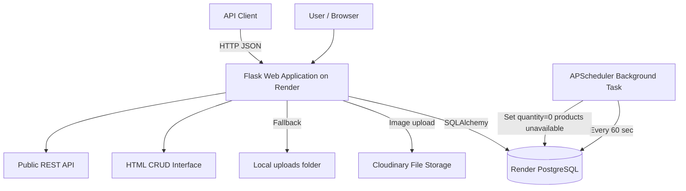

# Architecture

## Components

- **Web application:** Flask + Jinja templates.
- **Public API:** REST JSON endpoints under `/api/products`.
- **Database:** PostgreSQL on Render; SQLite fallback for local development.
- **File storage:** Cloudinary when `CLOUDINARY_URL` is configured; local upload fallback.
- **Background operation:** APScheduler runs every 60 seconds and automatically marks zero-stock products unavailable.
